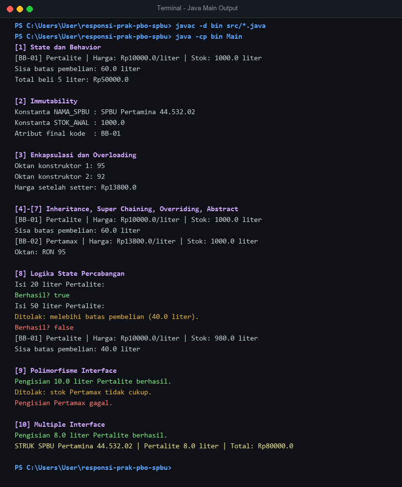

# Responsi Akhir Praktikum PBO - Sistem SPBU

## Identitas
- **Nama** : Narendro Gung Wicaksono
- **NIM** : H1D025062
- **Tema** : SPBU (digit terakhir NIM 2)

## Struktur Program

| File | Keterangan |
|---|---|
| `BahanBakar.java` | Superclass abstract |
| `Pertalite.java` | Subclass, implements `Pengisian` dan `Struk` |
| `Pertamax.java` | Subclass, implements `Pengisian` |
| `Pengisian.java` | Interface 1 |
| `Struk.java` | Interface 2 |
| `Main.java` | Pengujian 10 persyaratan |

## Cara Compile dan Run
Buka terminal pada folder project, lalu jalankan:

```bash
javac *.java
java Main
```

## Luaran Program (Console Output)

```text
[1] State dan Behavior
[BB-01] Pertalite | Harga: Rp10000.0/liter | Stok: 1000.0 liter
Sisa batas pembelian: 60.0 liter
Total beli 5 liter: Rp50000.0

[2] Immutability
Konstanta NAMA_SPBU : SPBU Pertamina 44.532.02
Konstanta STOK_AWAL : 1000.0
Atribut final kode  : BB-01

[3] Enkapsulasi dan Overloading
Oktan konstruktor 1: 95
Oktan konstruktor 2: 92
Harga setelah setter: Rp13800.0

[4]-[7] Inheritance, Super Chaining, Overriding, Abstract
[BB-01] Pertalite | Harga: Rp10000.0/liter | Stok: 1000.0 liter
Sisa batas pembelian: 60.0 liter
[BB-02] Pertamax | Harga: Rp13800.0/liter | Stok: 1000.0 liter
Oktan: RON 95

[8] Logika State Percabangan
Isi 20 liter Pertalite:
Berhasil? true
Isi 50 liter Pertalite:
Ditolak: melebihi batas pembelian (40.0 liter).
Berhasil? false
[BB-01] Pertalite | Harga: Rp10000.0/liter | Stok: 980.0 liter
Sisa batas pembelian: 40.0 liter

[9] Polimorfisme Interface
Pengisian 10.0 liter Pertalite berhasil.
Ditolak: stok Pertamax tidak cukup.
Pengisian Pertamax gagal.

[10] Multiple Interface
Pengisian 8.0 liter Pertalite berhasil.
STRUK SPBU Pertamina 44.532.02 | Pertalite 8.0 liter | Total: Rp80000.0
```

## Screenshot Output Program

